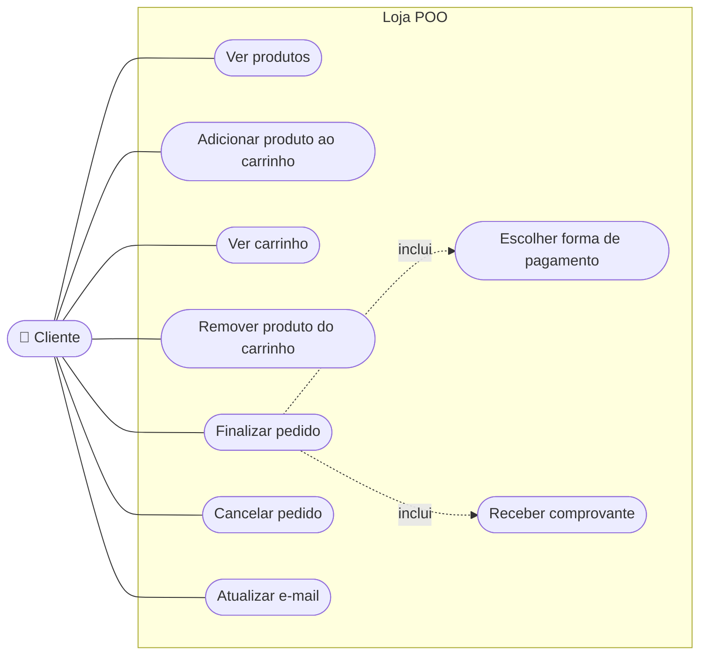

# Diagrama de casos de uso

Mostra **o que o cliente consegue fazer** na loja, sem dizer como o código faz. Cada elipse é um caso de uso.

## Casos de uso e as regras de negócio

| Caso de uso | Classe e método | Regras |
|---|---|---|
| Ver produtos | `Produto.__str__()` | - |
| Adicionar produto ao carrinho | `Carrinho.adicionar()` | RN4 e RN5 |
| Ver carrinho | `Carrinho.__str__()` e `Carrinho.total()` | - |
| Remover produto do carrinho | `Carrinho.remover()` | - |
| Finalizar pedido | `Pedido()` e `Pedido.confirmar()` | RN6, RN7 e RN11 |
| Escolher forma de pagamento | `Pix` ou `Cartao` | RN8, RN9 e RN10 |
| Receber comprovante | `gerar_comprovante()` | - |
| Cancelar pedido | `Pedido.cancelar()` | RN11 |
| Atualizar e-mail | `Cliente.atualizar_email()` | RN3 |

"Inclui" quer dizer que um caso de uso sempre acontece dentro do outro: para finalizar o pedido, o cliente sempre escolhe a forma de pagamento.

## Fontes

- **Como o diagrama foi construído:** com a linguagem Mermaid (https://mermaid.js.org/). O Mermaid não tem um tipo próprio para casos de uso, então o ator e as elipses foram desenhados com o tipo *flowchart*. Sintaxe em: https://mermaid.js.org/syntax/flowchart.html.
- **Como o GitHub desenha o diagrama:** Criar diagramas, na documentação do GitHub. Disponível em: https://docs.github.com/pt/get-started/writing-on-github/working-with-advanced-formatting/creating-diagrams.
- **O que é um diagrama de casos de uso:** Diagrama de caso de uso, na Wikipédia. Disponível em: https://pt.wikipedia.org/wiki/Diagrama_de_caso_de_uso.
- **O que é UML:** UML, na Wikipédia. Disponível em: https://pt.wikipedia.org/wiki/UML. Site oficial (em inglês): https://www.uml.org/.
- **Livro de apoio:** GUEDES, G. T. A. *UML 2: uma abordagem prática*. 3. ed. São Paulo: Novatec, 2018.
