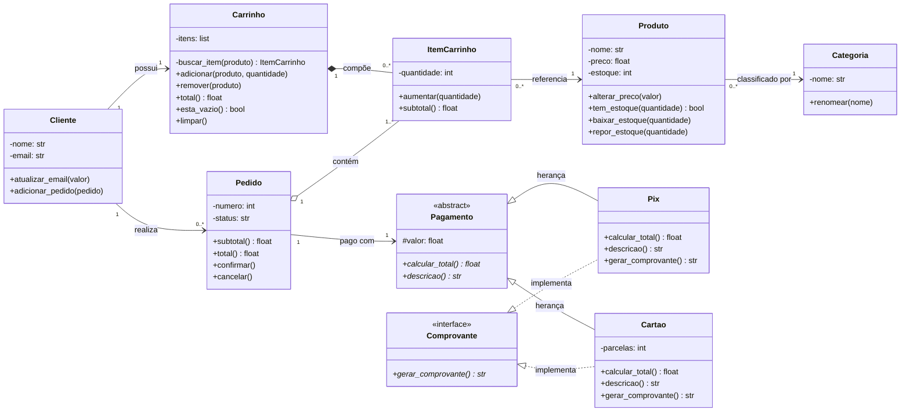

# Diagrama de classes

Mostra as **peças do sistema**: cada classe com seus atributos, seus métodos e as ligações entre elas.

## Como ler

| Símbolo | Significado | Exemplo no projeto |
|---|---|---|
| `+` | público | `+total()` |
| `-` | privado (no código: `__nome`) | `-preco` |
| `#` | protegido (no código: `_valor`) | `#valor` |
| seta simples | associação: uma classe conhece a outra | Produto conhece a sua Categoria |
| losango cheio | composição: a parte não existe sem o todo | Carrinho cria os seus ItemCarrinho |
| losango vazio | agregação: o todo recebe partes que já existem | Pedido recebe os itens do carrinho |
| triângulo com linha cheia | herança ("é um") | Pix é um Pagamento |
| triângulo com linha tracejada | implementa uma interface ("tem a capacidade de") | Pix gera Comprovante |
| `<<abstract>>` | classe abstrata: não cria objeto | Pagamento |
| `<<interface>>` | interface: só define o contrato | Comprovante |

## Onde está cada classe

| Classe | Arquivo | Aula |
|---|---|---|
| Produto | `src/models/produto.py` | 03/11 |
| Categoria | `src/models/categoria.py` | 05/11 |
| Cliente | `src/models/cliente.py` | 10/11 |
| ItemCarrinho | `src/models/item_carrinho.py` | 10/11 |
| Carrinho | `src/models/carrinho.py` | 10/11 |
| Pagamento | `src/models/pagamento.py` | 12/11 |
| Comprovante | `src/models/comprovante.py` | 12/11 |
| Pix | `src/models/pix.py` | 12/11 |
| Cartao | `src/models/cartao.py` | 12/11 |
| Pedido | `src/models/pedido.py` | 12/11 |

## Fontes

- **Como o diagrama foi construído:** com a linguagem Mermaid (https://mermaid.js.org/), usando o tipo *class diagram*. Sintaxe em: https://mermaid.js.org/syntax/classDiagram.html.
- **Como o GitHub desenha o diagrama:** Criar diagramas, na documentação do GitHub. Disponível em: https://docs.github.com/pt/get-started/writing-on-github/working-with-advanced-formatting/creating-diagrams.
- **O que é um diagrama de classes:** Diagrama de classes, na Wikipédia. Disponível em: https://pt.wikipedia.org/wiki/Diagrama_de_classes.
- **O que é UML:** UML, na Wikipédia. Disponível em: https://pt.wikipedia.org/wiki/UML. Site oficial (em inglês): https://www.uml.org/.
- **Livro de apoio:** GUEDES, G. T. A. *UML 2: uma abordagem prática*. 3. ed. São Paulo: Novatec, 2018.
- **Classes em Python:** O tutorial Python, capítulo Classes. Disponível em: https://docs.python.org/pt-br/3/tutorial/classes.html.
