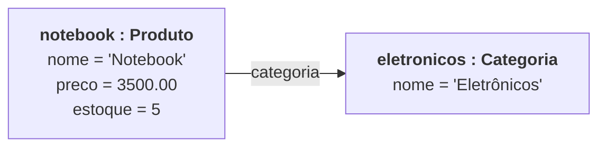
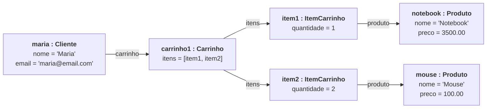

# Diagrama de objetos

O diagrama de **classes** mostra os modelos. O diagrama de **objetos** mostra uma "foto" do programa rodando: quais objetos existem naquele momento e quais valores eles guardam.

Cada caixa é um objeto, escrito como `nome : Classe`.

## 05/11 - Produto e Categoria

Código que gera esta foto:

```python
eletronicos = Categoria("Eletrônicos")
notebook = Produto("Notebook", 3500, 5, eletronicos)
```



Se a categoria for renomeada, o produto mostra o nome novo, porque ele guarda o **objeto** `eletronicos`, e não uma cópia do texto.

## 10/11 - Um carrinho com dois itens

Código que gera esta foto:

```python
maria = Cliente("Maria", "maria@email.com")
maria.carrinho.adicionar(notebook, 1)
maria.carrinho.adicionar(mouse, 2)
```



- O cliente **tem** um carrinho (associação).
- O carrinho **compõe** os itens (composição).
- Cada item **referencia** um produto (associação).
- Total do carrinho: 1 x 3500.00 + 2 x 100.00 = **3700.00**.

## Diferença entre os dois diagramas

| Diagrama de classes | Diagrama de objetos |
|---|---|
| Mostra os modelos (`Produto`) | Mostra os objetos criados (`notebook`, `mouse`) |
| Mostra o tipo do atributo (`preco: float`) | Mostra o valor do atributo (`preco = 3500.00`) |
| Vale para o programa inteiro | Vale para um momento do programa |

## Fontes

- **Como o diagrama foi construído:** com a linguagem Mermaid (https://mermaid.js.org/). O Mermaid não tem um tipo próprio para diagrama de objetos, então as caixas foram desenhadas com o tipo *flowchart*. Sintaxe em: https://mermaid.js.org/syntax/flowchart.html.
- **Como o GitHub desenha o diagrama:** Criar diagramas, na documentação do GitHub. Disponível em: https://docs.github.com/pt/get-started/writing-on-github/working-with-advanced-formatting/creating-diagrams.
- **O que é um diagrama de objetos:** Diagrama de objetos, na Wikipédia. Disponível em: https://pt.wikipedia.org/wiki/Diagrama_de_objetos.
- **O que é UML:** UML, na Wikipédia. Disponível em: https://pt.wikipedia.org/wiki/UML. Site oficial (em inglês): https://www.uml.org/.
- **Livro de apoio:** GUEDES, G. T. A. *UML 2: uma abordagem prática*. 3. ed. São Paulo: Novatec, 2018.
