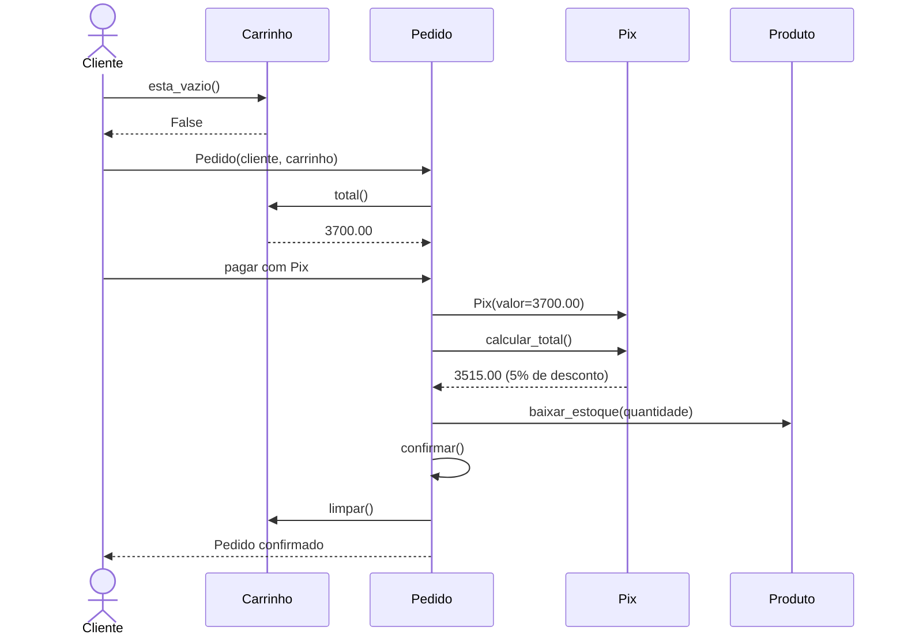
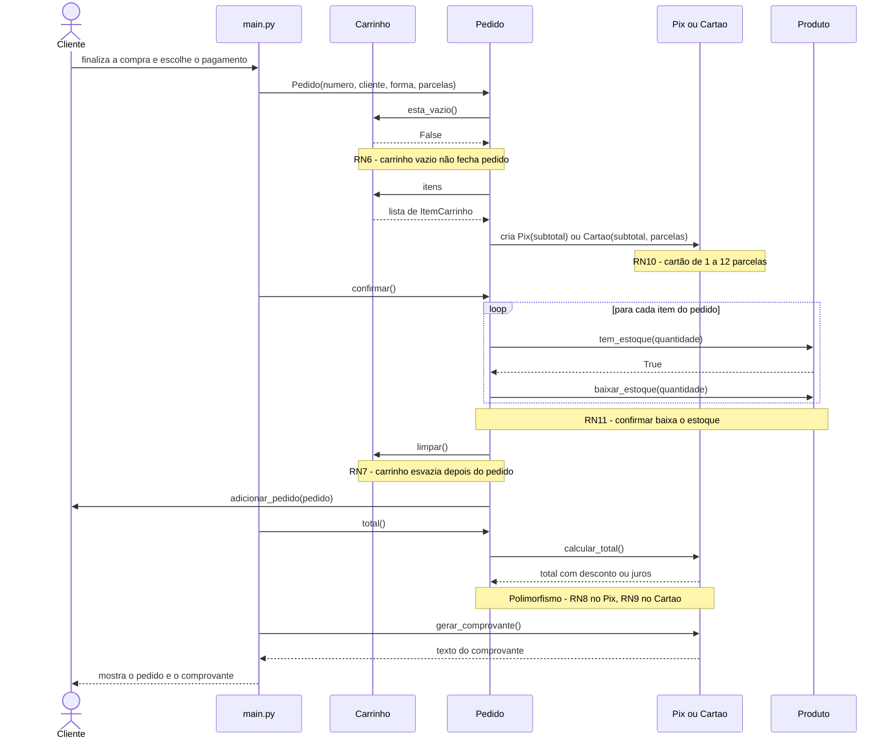

# Diagrama de sequência: finalização do pedido

Mostra a **ordem das mensagens** entre os objetos quando o cliente finaliza a compra. Lê-se de cima para baixo.

## Finalização do pedido (17/11)

Compra de conferência: 1 Notebook e 2 Mouses, paga com Pix.

## Versão detalhada: como está no código

Corresponde ao trecho do pedido em `src/main.py`, com todas as chamadas e as regras de negócio.

## Como ler

- Cada coluna é um participante: o cliente (pessoa) e os objetos do sistema.
- Seta cheia: uma chamada de método. Seta tracejada: a resposta.
- O quadro `loop` repete as mensagens para cada item do pedido.
- O `Pedido` chama `calcular_total()` **sem saber** se o pagamento é `Pix` ou `Cartao`: isso é polimorfismo.

## Compra de conferência

| Passo | Valor |
|---|---|
| 1 Notebook (3500.00) + 2 Mouses (100.00 cada) | 3700.00 |
| Pagamento com Pix (5% de desconto) | 3515.00 |
| Pagamento com Cartão em até 3x | 3700.00 |
| Pagamento com Cartão em 4x ou mais (10% a mais) | 4070.00 |

## Fontes

- **Como o diagrama foi construído:** com a linguagem Mermaid (https://mermaid.js.org/), usando o tipo *sequence diagram*. Sintaxe em: https://mermaid.js.org/syntax/sequenceDiagram.html.
- **Como o GitHub desenha o diagrama:** Criar diagramas, na documentação do GitHub. Disponível em: https://docs.github.com/pt/get-started/writing-on-github/working-with-advanced-formatting/creating-diagrams.
- **O que é um diagrama de sequência:** Diagrama de sequência, na Wikipédia. Disponível em: https://pt.wikipedia.org/wiki/Diagrama_de_sequ%C3%AAncia.
- **O que é UML:** UML, na Wikipédia. Disponível em: https://pt.wikipedia.org/wiki/UML. Site oficial (em inglês): https://www.uml.org/.
- **Livro de apoio:** GUEDES, G. T. A. *UML 2: uma abordagem prática*. 3. ed. São Paulo: Novatec, 2018.
- **Polimorfismo e herança em Python:** O tutorial Python, seção Herança. Disponível em: https://docs.python.org/pt-br/3/tutorial/classes.html#inheritance.
